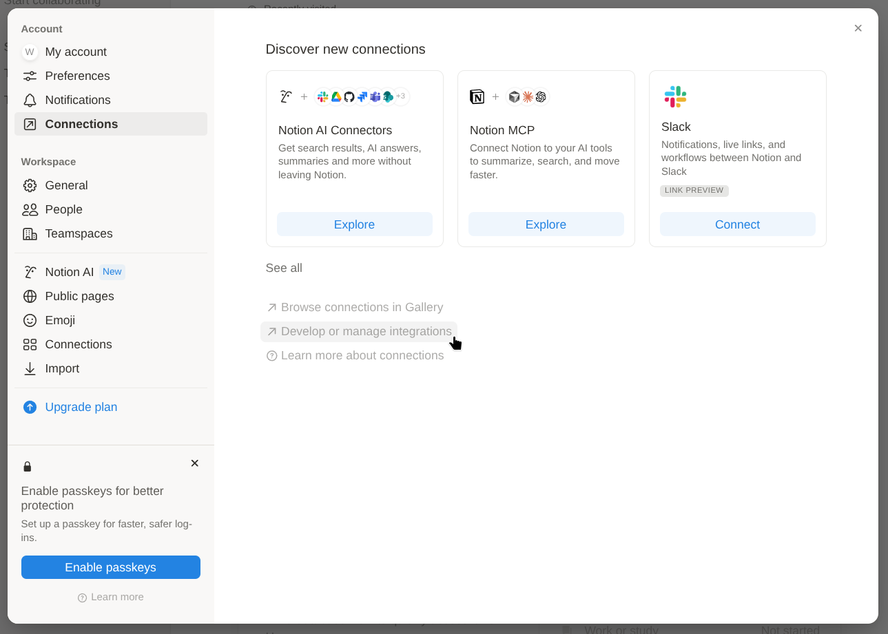
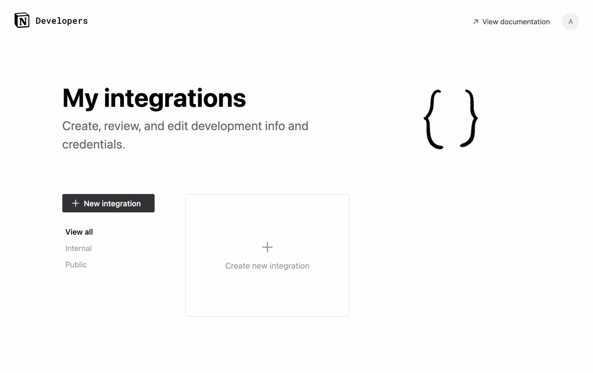
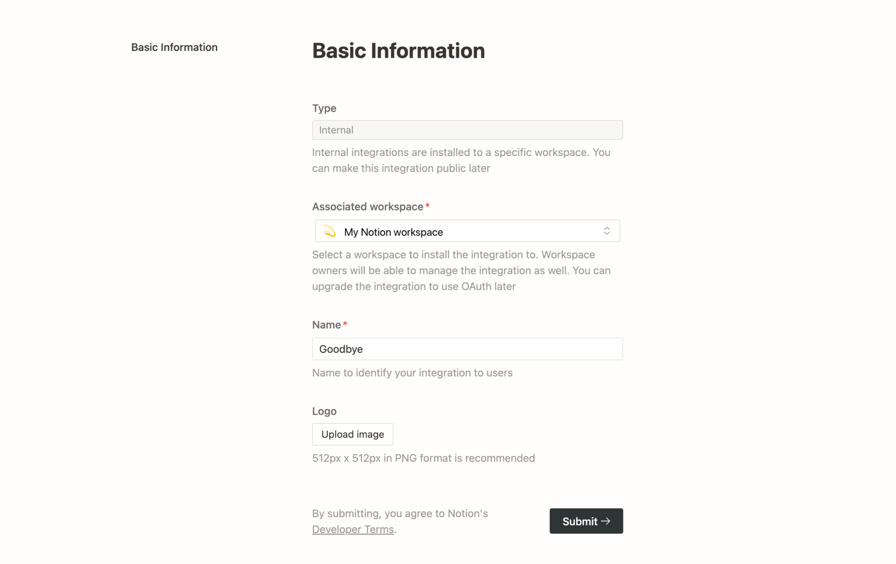
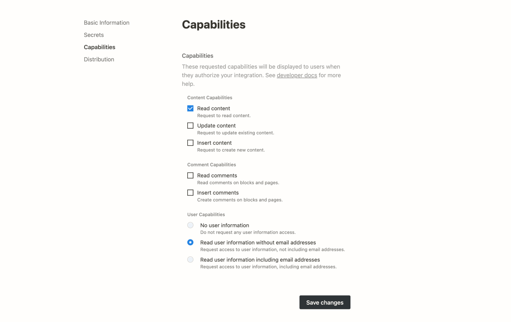
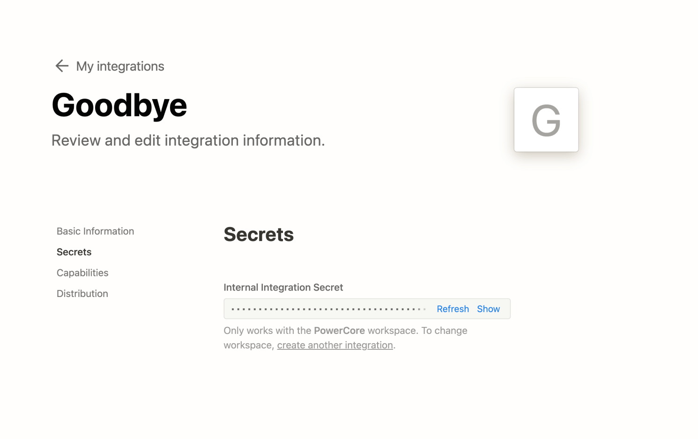
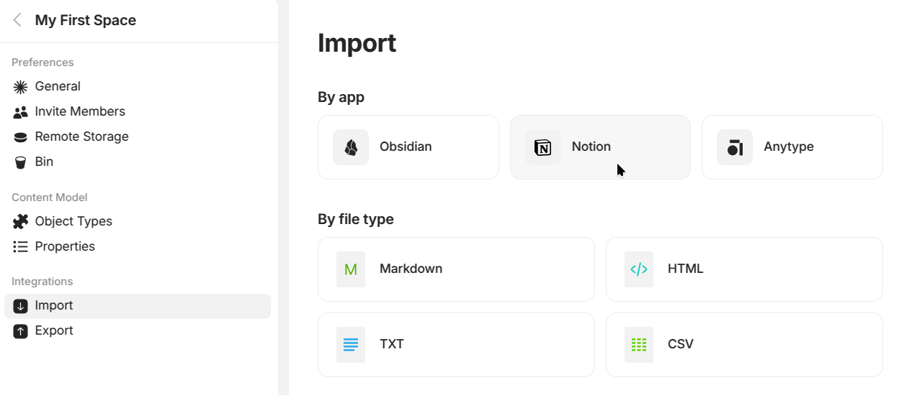
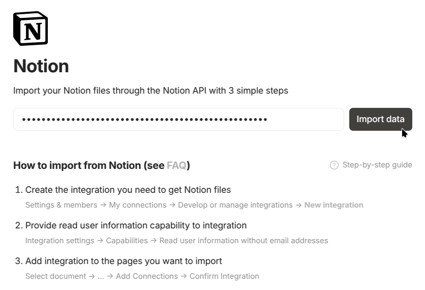

# Migrar desde Notion

### Paso 1: Crear la integración en Notion

1.  En Notion, **abre Configuración.**\\

    <figure><figcaption></figcaption></figure>
2.  **Abre «Mis conexiones» y luego haz clic en «Desarrollar o gestionar las integraciones» (o** [**ve directamente a la página**](https://www.notion.so/profile/integrations)**).**

    <figure><figcaption></figcaption></figure>
3.  **Crea una «Nueva integración».**

    <figure><figcaption></figcaption></figure>
4.  **Guarda un nombre para la integración con el espacio de trabajo seleccionado y establece el tipo como «Interna».**

    <figure><figcaption></figcaption></figure>
5. **¡Importante!**\\
   Desplázate hasta **Permisos**, selecciona los permisos siguientes y haz clic en Guardar para guardar los cambios:

* Leer contenido
*   Leer información de usuario

    <figure><figcaption></figcaption></figure>

6. **¡Importante!**\\
   Ve a **Acceso** y selecciona el espacio de equipo que quieres importar. Luego, pulsa **Actualizar acceso**. Asegúrate de seleccionar todas las páginas raíz para evitar enlaces rotos en Anytype después de la importación.
7.  **Copia el código secreto de integración interna** para conectar e importar tus datos.

    <figure><figcaption></figcaption></figure>

### Paso 2: Ejecutar la integración en tu espacio de Anytype

1. Para **preparar una importación sin problemas**:

* Usa una buena conexión a internet, sobre todo si tienes un gran número de archivos.
* Mantén el ordenador conectado a la corriente.
* Desactiva el modo de suspensión de tu ordenador para que el proceso de importación se realice sin interrupciones.


Es posible que algunos datos de Notion **no se importen correctamente**, ya que no todas las funciones de Notion son compatibles con Anytype.


2.  En los ajustes de tu espacio de Anytype (haz clic en el nombre de tu espacio en la parte superior izquierda), **selecciona «Importar» y elige «Notion»**.

    <figure><figcaption></figcaption></figure>
3.  **Introduce el código secreto de integración** y **haz clic en «Importar datos»**.

    <figure><figcaption></figcaption></figure>

### Preguntas frecuentes

¿Por qué no se han importado bien algunos datos de Notion?

No todas las funciones de Notion son compatibles con Anytype, así que no podemos garantizar que todos los datos de Notion se importen correctamente.

E:jemplos

* Las menciones a usuarios (@) se convertirán en texto simple.
* Los intervalos de fechas se importarán como texto.
* Los datos de fórmulas y totales se importarán como valores.

¿Por qué veo «página no encontrada» en lugar de enlaces tras la importación de Notion a Anytype?

Este problema aparece cuando tienes enlaces a páginas que no pertenecen a la estructura de tu espacio de trabajo de Notion. Es posible que estas páginas no se conecten a la integración de forma correcta durante la importación y esto genere enlaces rotos en Anytype.

**Solución:**

* **Comprueba las conexiones de las páginas.** Asegúrate de que todas las páginas de tu espacio de trabajo de Notion están conectadas antes de iniciar el proceso de importación. Si alguna página no está bien conectada a la integración, puede que no se importe correctamente. Revisa el [paso 1 de esta guía](#paso-1-crear-la-integracion-en-notion) para ver más detalles.
* **Repite la importación.** Si no se importa alguna página, añade la conexión que falta y repite la importación.

¿Por qué faltan algunos archivos tras la importación de Notion a Anytype?

Pueden faltar archivos por dos razones principales:

* **Falta alguna conexión.** Antes de importar, asegúrate de que la página de Notion que contiene los archivos está conectada a la integración. Si falta la conexión, es posible que los archivos no se importen.
* **La conexión a internet es lenta.** Si tu conexión a internet tiene poca velocidad y el número de archivos es grande, puede que los enlaces a esos archivos caduquen durante la descarga y los archivos no lleguen.

**Solución:**

* **Comprueba las conexiones.** Antes de importar, asegúrate de que tanto las páginas como sus respectivos archivos están conectados en Notion.
* **Usa una conexión a internet más rápida.** Si puedes, usa una conexión a internet más rápida durante el proceso de importación para evitar que los enlaces caduque.
* **Añade manualmente los archivos que faltan.** Si falta algún archivo tras la importación, quizás tengas que subirlos a Anytype por tu cuenta.

¿Por qué tarda tanto la importación de Notion a Anytype?

El proceso de importación usa la API de Notion para transferir los datos de la forma más precisa posible. Aunque este método es más fiable que una exportación a Markdown, el inconveniente es que realiza muchas solicitudes. Pasado un tiempo, es posible que Notion comience a limitar la velocidad de las solicitudes y esto provoque retrasos.

**Solución:**

* **Enchufa tu dispositivo:** asegúrate de que el dispositivo esté conectado a una fuente de alimentación durante la importación.
* **Desactiva el modo de suspensión:** evita que el dispositivo entre en suspensión para que no se interrumpa el proceso de importación.
* **Ten paciencia:** deja que se ejecute el proceso de importación hasta el final. Puede tardar un tiempo, sobre todo si hay gran cantidad de datos.

Tengo otro problema con la importación de Notion o ya no tengo acceso a mi espacio de trabajo de Notion

Si tienes problemas con la importación de Notion (que funciona a través de la API de Notion) o has perdido el acceso completo a tu espacio de trabajo de Notion, puedes exportar el espacio de trabajo desde Notion como archivos Markdown y CSV para importarlos a Anytype con la opción de importación de Markdown.

Ten en cuenta que la importación mediante archivos Markdown y CSV conserva menos datos que con la API de Notion. Esto se debe a que no es posible trasladar al formato Markdown todos los métodos que usa Notion para vincular documentos y archivos CSV, por lo que la estructura y los enlaces pueden perderse.

**Solución:**

* **Exporta desde Notion:** desde tu espacio de trabajo de Notion, exporta los datos como archivos Markdown y CSV.
* **Importa a Anytype:** usa la función de importación de Markdown en Anytype para incorporar el contenido exportado a tu espacio de Anytype.

