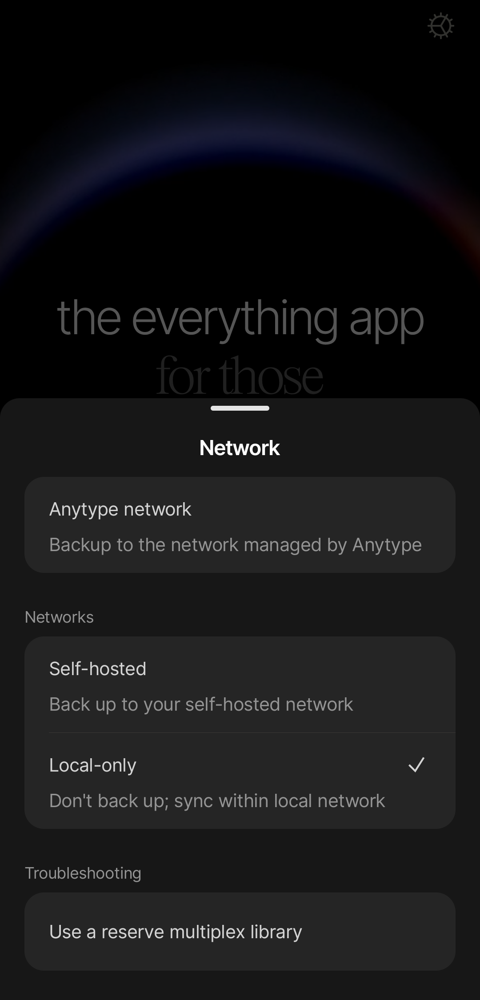

# Solo local

Si prefieres que tus datos estén solo en tu dispositivo, sin ningún servidor que los sincronice entre tu ordenador y tu móvil, puedes activar el modo solo local. Este modo desactiva por completo el nodo de respaldo de Anytype, por lo que los dispositivos solo se sincronizarán cuando estén en la misma red local y tus datos residirán exclusivamente en ellos.


**El modo solo local se considera experimental** porque gestionar a mano las copias de respaldo conlleva un alto riesgo de pérdida accidental de datos. Si eliges este modo, recuerda exportar tus datos con regularidad y organizar tus copias de respaldo. Anytype no tiene ninguna posibilidad de ayudarte a recuperar tus datos con el modo solo local.


## Cómo funciona

Anytype se basa en [principios de prioridad local](https://www.inkandswitch.com/essay/local-first/) (local-first): está pensado para personas que aprecian la comodidad de las aplicaciones de nube actuales, pero no quieren sacrificar su privacidad, su seguridad o la propiedad de sus datos. Este artículo en inglés expone, entre otras cosas, la diferencia entre «solo local» (local-only) y «prioridad local» (local-first):

#### **Solo local**

* Almacenamiento: los datos residen exclusivamente en tu dispositivo.
* Sincronización:  no hay sincronización por medio de un servidor.
* Riesgo: si tu dispositivo se rompe o se pierde, tus datos desaparecen para siempre.
* Copias de respaldo: realizadas a mano y bajo tu exclusiva responsabilidad.

#### **Prioridad local (red de Anytype)**

* Almacenamiento: los datos residen en tu dispositivo y están disponibles sin conexión.
* Sincronización:  se sincronizan automáticamente en todos tus dispositivos mediante cifrado de extremo a extremo cuando hay una conexión.
* Privacidad: solo tú tienes las claves para descifrarlos; Anytype no puede leer tu contenido por ningún medio.
* Recuperación: si pierdes todos tus dispositivos, puedes recuperar los datos desde el nodo de respaldo cifrado de Anytype.
* Riesgo: si alguien consigue tu [clave](../../basics/key.md), puede obtener acceso a tu [arca](../../basics/vault.md). Es muy importante que guardes tu clave de forma segura; si tu arca queda expuesta, no tendrás más remedio que eliminarla, ya que no existe ninguna contraseña o cuenta que puedas restablecer para recuperar el control del arca. 

En resumen: «solo local» significa que funciona sin conexión y sin sincronización con un servidor; «prioridad local» significa que funciona sin conexión, se sincroniza con cifrado de extremo a extremo entre distintos dispositivos y solo tienen acceso quienes poseen la clave.

### ¿Debería usar el modo solo local?

El modo de prioridad local que usa la red de Anytype es la mejor opción en general. 

Anytype está diseñado para ser privado por defecto. Puesto que las claves de cifrado se generan en tu dispositivo y nunca lo abandonan, tus datos son completamente inaccesibles para cualquier otra persona. Este diseño se puede verificar en nuestro código abierto. El modo con red de Anytype, habilitado por defecto, ofrece un equilibro estupendo entre seguridad y comodidad.

Por el contrario, el modo solo local ofrece escasa seguridad añadida a las personas corrientes y aumenta considerablemente el riesgo de perder los datos de forma irrecuperable. A menos que tu modelo de seguridad requiera un aislamiento estricto de la red (por ejemplo, trabajar con un dispositivo sin conexión), te recomendamos elegir el modo de prioridad local con conexión a la red de Anytype.

El uso del modo solo local queda bajo tu exclusiva responsabilidad. 

## Cómo cambiar al modo solo local

#### Escritorio

1. Cierra la sesión de tu identidad actual.
2. En la pantalla de incorporación, haz clic en el icono de engranaje de la esquina superior derecha.
3. En el campo «Red», elige la opción «Solo local».
4. Haz clic en el botón «Guardar».
5. Crea una identidad nueva o inicia sesión con una existente.

<figure><figcaption></figcaption></figure>

#### Móvil

1. Cierra la sesión de tu identidad actual.
2. En la pantalla de incorporación, haz clic en el icono de engranaje de la esquina superior derecha.
3. En el submenú «Redes», haz clic en «Solo local».
4. Crea una identidad nueva o inicia sesión con una existente.

<figure><figcaption></figcaption></figure>

## Cómo recuperar datos en modo solo local

En el modo solo local, eres responsable de tus datos al 100 %. Como Anytype no tiene ningún acceso a tu dispositivo ni a tus claves de cifrado, no podemos ayudarte a recuperar datos perdidos, eliminados o dañados. Tampoco hay copias de respaldo guardadas en nuestros nodos.

**Para proteger tu trabajo ante fallos del dispositivo o una eliminación accidental, debes exportar tus espacios con regularidad y guardar una copia de respaldo en una ubicación externa segura.**


**Si sufres una pérdida de datos en modo solo local, Anytype no podrá ayudarte a recuperarlos.** Puedes investigar métodos de recuperación para tu sistema en el foro de la comunidad de Anytype o en otros foros generales.



**No uses unidades de red ni servicios de terceros para sincronizar**: es muy probable que esto cause daños en los datos. [Tienes más información aquí](../sync-and-backup/#servicios-de–terceros-y-unidades-de-red). 

