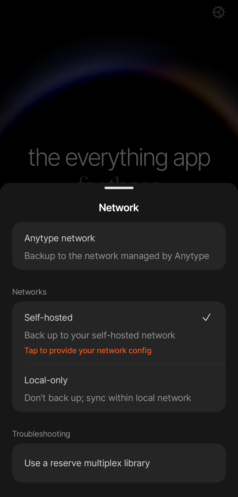

# Autoalojamiento

Para tener una copia de respaldo de tus canales y datos en una red alojada por ti, necesitas tener una configuración de red. Si aún no tienes una red propia, aquí puedes ver [una guía práctica](https://tech.anytype.io/how-to/self-hosting). También existe una [imagen de docker](https://github.com/anyproto/any-sync-dockercompose) mantenida por nuestro equipo. Uno de nuestros desarrolladores ha creado esta guía en vídeo para quien quiera configurar su propia red autoalojada:



## Cómo cambiar a una red autoalojada

Te recomendamos encarecidamente que uses una identidad distinta para cada red. Si ya tienes una identidad en la red de Anytype y quieres cambiar a una red autoalojada, exporta todos tus canales e impórtalos a una identidad nueva antes de cambiar el modo de red.

Ten en cuenta que deberás cambiar manualmente todos tus dispositivos a la misma red autoalojada.

#### Escritorio

1. Cierra la sesión de tu identidad actual.
2. En la pantalla de incorporación, haz clic en el icono de engranaje de la esquina superior derecha.
3. En el campo «Red», elige la opción «Autoalojado».
4. Carga la configuración de tu red autoalojada (archivo *.yml) en el campo correspondiente.
5. Haz clic en el botón «Guardar».
6. Crea una identidad nueva o inicia sesión con una existente.

<figure><figcaption></figcaption></figure>

#### Móvil

1. Cierra la sesión de tu identidad actual.
2. En la pantalla de incorporación, pulsa el icono de engranaje de la esquina superior derecha.
3. En el submenú «Redes», pulsa «Autoalojado».
4. Pulsa «Toda para cargar tu configuración de red» y carga la configuración de tu red autoalojada (archivo *.yml).
5. Crea una identidad nueva o inicia sesión con una existente.

<figure><figcaption></figcaption></figure>

## Requisitos de hardware

Los requisitos del hardware dependen del tipo de autoalojamiento: 

* Para Docker Compose, [aquí se indican los requisitos mínimos](https://github.com/anyproto/any-sync-dockercompose#requirements.). 
* Para Ansible/Puppet, los requisitos son similares, posiblemente menos exigentes.
